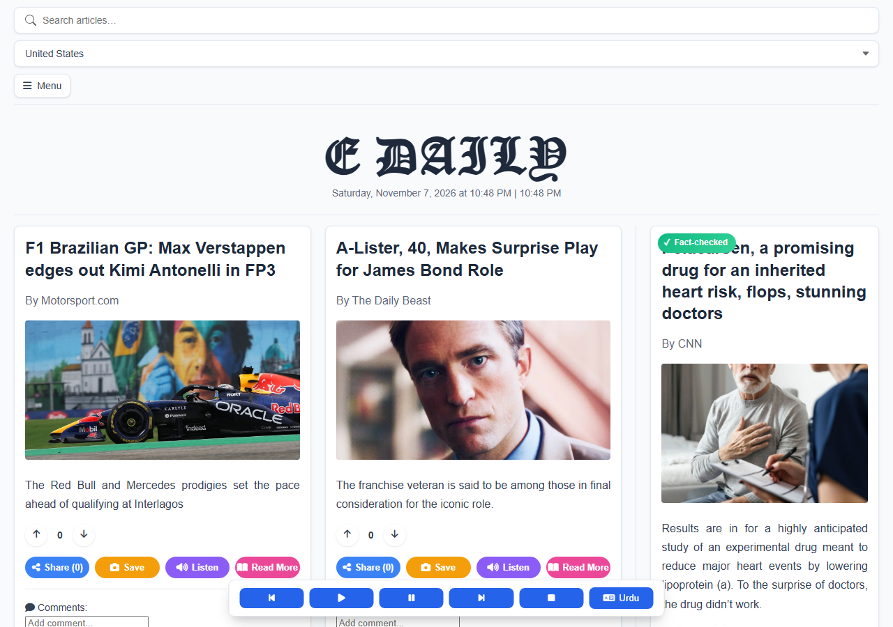

# E Daily

A single self-contained HTML page that aggregates live news into a
newspaper-style reading experience, entirely client-side.

## Screenshots

| Light | Dark |
|---|---|
|  |  |

## Features

- Live article feed with search and a country filter
- Per-article share / save / text-to-speech ("Listen") / read-more actions, and comments
- A menu with: a world map view (Leaflet + heatmap), theme toggle (light/dark),
  PDF export of the current page (html2canvas + jsPDF), breaking-news alerts,
  and a financial markets panel with stock charts (Chart.js)
- Fact-check badges on applicable articles

## Running it

No build step, no dependencies to install. Open `E-paper.html` directly in a
browser, or serve it:

```sh
python3 -m http.server 8000
# then visit http://localhost:8000/E-paper.html
```

All libraries (Leaflet, Leaflet.heat, Chart.js, html2canvas, jsPDF, Font
Awesome) load from CDNs with pinned versions.
